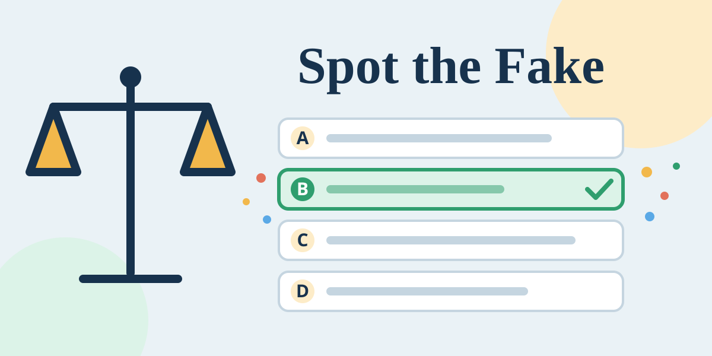

# Spot the Fake

A short team quiz game for law students and lawyers who want to practice the New York Rules of Professional Conduct.

## Play it

Web address: _(add your link here)_

You need a phone or a computer with a web browser. Play alone, or with 2 to 4 people sharing one screen.

## How to play

1. Tap **Start**.
2. Each round shows one topic, like client money or advertising, and four statements about it.
3. Three statements are true. One is fake. Talk it over with your team.
4. Tap the one you think is fake. If you are right on the first tap, the team gets a point. If not, try again.
5. Read why the fake is false, then tap **Next round**.
6. There are 8 rounds. Get 6 or more right on the first tap and the team wins.

This game is for fun and practice. It is not legal advice. Check the current NY Rules of Professional Conduct.

## Play test log

| Round | Who played | Where they got stuck | What I changed |
|-------|------------|----------------------|----------------|
| 1 |  |  |  |
|   |  |  |  |

## Made with

Built with Claude in Vibe Coding for Nonprofits, a Whole Whale × Meet the Moment accelerator.
